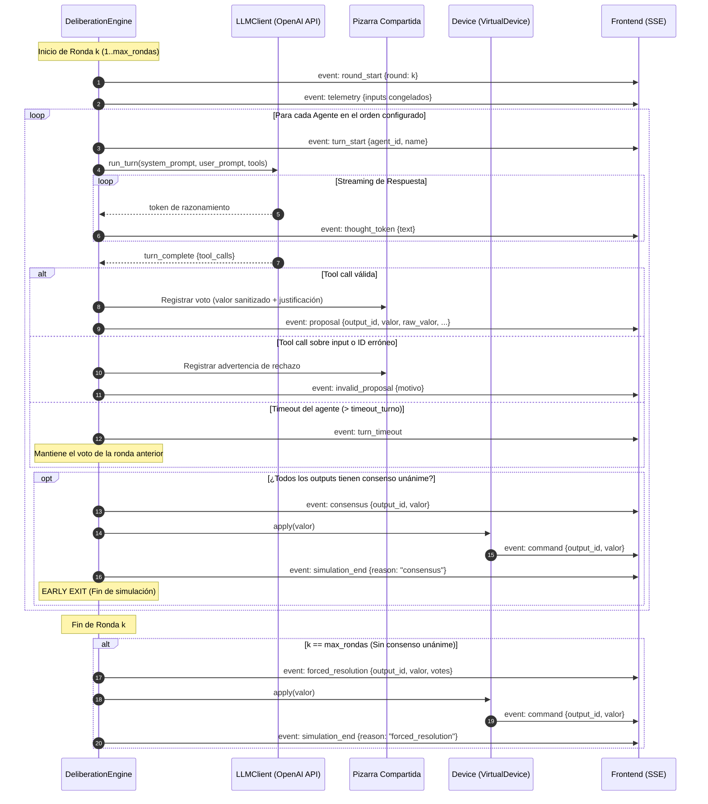

# AGENTS.md — Arquitectura y Funcionamiento del Sistema Multiagente

Este documento describe en detalle la arquitectura, el ciclo de vida, los protocolos de deliberación y las reglas operativas de los agentes de Inteligencia Artificial en el **Laboratorio de Deliberación entre Agentes**.

---

## 1. Visión General y Filosofía de Diseño

El **Laboratorio de Deliberación** es un entorno experimental para observar, analizar y guiar el comportamiento de agentes basados en Modelos de Lenguaje Grande (LLMs) cuando deben **coordinarse y tomar decisiones conjuntas sobre actuadores compartidos** (virtuales o físicos).

### Principio Rector: Separación Estricta entre Decisión y Ejecución
> [!IMPORTANT]
> **Los agentes nunca ejecutan acciones directamente sobre el hardware.**
> Los agentes debaten, argumentan y registran sus votos a través de la herramienta formal `propose_output`. El **Orquestador (`DeliberationEngine`)** es la única entidad con autoridad para verificar consensos, resolver empates y emitir comandos a los dispositivos (`Device`).

```
                    ┌───────────────────────────────┐
                    │       Usuario / Frontend      │
                    │ (Configura agentes y sensores)│
                    └──────────────┬────────────────┘
                                   │ POST /experiment/start
                                   ▼
                    ┌───────────────────────────────┐
                    │      DeliberationEngine       │
                    │   (Orquestador del debate)    │
                    └───┬───────────────────────▲───┘
     Ronda k:           │ Telemetría +          │ Streaming de pensamiento
     Snapshot inputs    │ Pizarra (n mensajes)  │ + propose_output()
                        ▼                       │
             ┌─────────────────────┐            │
             │     Agente LLM      │────────────┘
             │  (Personalidad pura)│
             └─────────────────────┘
                        │
                        ▼ (Alcanzado consenso o fin de rondas)
             ┌─────────────────────┐
             │       Device        │
             │   (VirtualDevice)   │ ──► {"type": "command", "valor": ...}
             └─────────────────────┘
```

---

## 2. Anatomía de un Agente (`Agent`)

En el modelo de datos (`backend/models.py`), cada agente se define mediante:

| Campo | Tipo | Descripción |
| :--- | :--- | :--- |
| `id` | `str` | Identificador único alfanumérico generado automáticamente (`uuid4().hex[:8]`). |
| `name` | `str` | Nombre descriptivo del agente (ej. *"Prudente"*, *"Ahorrador"*, *"Agente de Confort"*). |
| `personality` | `str` | Prompt que define exclusivamente el rol, prioridades y sesgos de decisión. |
| `model` | `Optional[str]` | Modelo LLM opcional específico para este agente. Si es `None`, hereda el modelo por defecto del sistema (`OPENAI_MODEL`). |

### Inyección de Prompts: Personalidad vs. Reglas de Plataforma
El autor del experimento define **únicamente** la personalidad del agente. La plataforma inyecta de forma determinista la estructura operativa en dos prompts:

#### 1. System Prompt (`_system_prompt`)
Se construye dinámicamente según la modalidad (multiagente o solitario) y contiene:
1. **Identidad del Agente**: `Eres "{agent.name}"...`
2. **Personalidad del Alumno/Usuario**: Bloque textual íntegro provisto al crear el agente.
3. **Reglas Operativas del Sistema**:
   - Obligación de argumentar brevemente en texto y emitir `propose_output` para **cada** output definido.
   - Notificación de que `propose_output` no ejecuta, sino que registra el voto en la pizarra.
   - Condición de parada: CONSENSO unánime o resolución por mayoría en la ronda límite.
   - Advertencia de que los **inputs son de solo lectura** (telemetría inmutable durante el debate).
4. **Catálogo de Outputs**: Lista de actuadores con sus IDs exactos, descripciones y valores válidos.

#### 2. User Prompt (`_user_prompt`)
Se genera al inicio de cada turno individual y contiene:
1. **Estado de la Ronda**: Indicador `Ronda k de max_rondas`.
2. **Telemetría Congelada**: Snapshot inmutable de todos los inputs (`nombre`, `descripción`, `valor`).
3. **Pizarra Compartida (*Blackboard*)**: Ventana deslizante de los últimos `n_mensajes` registrados por cualquier agente (votos previos, justificaciones y votos rechazados).
4. **Llamada a la Acción**: Instrucción explícita de argumentar y emitir los votos correspondientes.

---

## 3. Las Herramientas del Agente: `propose_output` y `abstain_output`

Los agentes disponen de dos herramientas formales (`TOOLS_SCHEMA`) provistas a través del protocolo de llamadas a herramientas (*tool calling*) de OpenAI:

### A. Voto Activo: `propose_output`
Permite proponer un valor para un actuador:
```json
{
  "name": "propose_output",
  "description": "Registra tu voto para un output compartido. No ejecuta nada directamente: el orquestador aplicará al dispositivo el valor final consensuado.",
  "parameters": {
    "type": "object",
    "properties": {
      "output_id": {
        "type": "string",
        "description": "Identificador exacto del output sobre el que votas (usa su id, no su nombre)"
      },
      "valor": {
        "type": "string",
        "description": "Valor propuesto (uno de los valores válidos del output, o 'ABSTAIN' si decides abstenerte)"
      },
      "justificacion": {
        "type": "string",
        "description": "Justificación breve, coherente con tu personalidad"
      }
    },
    "required": ["output_id", "valor", "justificacion"]
  }
}
```

### B. Abstención Dinámica: `abstain_output`
Permite a un agente no emitir voto sobre actuadores que considere fuera de su especialidad, rol o competencia:
```json
{
  "name": "abstain_output",
  "description": "Indica formalmente que te abstienes de votar sobre este output porque no compete a tu rol, personalidad o especialidad. Permite que los demás agentes decidan sin tu bloqueo.",
  "parameters": {
    "type": "object",
    "properties": {
      "output_id": {
        "type": "string",
        "description": "Identificador exacto del output sobre el que te abstienes"
      },
      "justificacion": {
        "type": "string",
        "description": "Motivo por el que consideras que no debes votar sobre este output"
      }
    },
    "required": ["output_id", "justificacion"]
  }
}
```
*(Nota: también se admite invocar `propose_output` con `valor: "ABSTAIN"` de forma indistinta).*

---

## 4. El Motor de Deliberación (`DeliberationEngine`)

El motor orquesta la ejecución mediante un esquema **Round-Robin estricto y síncrono** dividido en rondas:



### Reglas de Decisión y Salida

#### A. Consenso Unánime (Early Exit)
- Evaluado inmediatamente después de cada turno individual.
- Se produce cuando **todos** los agentes han participado para el output y no hay discrepancias entre los votos activos:
  1. **Unanimidad activa**: Todos los agentes que votan coinciden en la misma opción (`len(set(no_abstenidos)) == 1`), independientemente de cuántos agentes hayan elegido abstenerse (`ABSTAIN`).
  2. **Abstención total**: Si **todos** los agentes deciden abstenerse para un output, hay consenso unánime en no intervenir y el actuador adopta automáticamente su `safe_value`.
- Si todos los outputs alcanzan consenso, la simulación termina de inmediato sin agotar las rondas restantes.

#### B. Resolución Forzada (Agotamiento de Rondas)
Si se alcanza `max_rondas` sin unanimidad:
1. **Mayoría Simple**: Se contabilizan los votos vigentes entre los agentes **no abstenidos**. Si una opción supera en votos a la segunda más votada, resulta elegida.
2. **Empate, Falta de Mayoría o Abstención Plena**: Si no existe una opción estrictamente mayoritaria entre los votantes (o todos se abstuvieron), se adopta el **`safe_value`** configurado en el output.

#### C. Modo Agente Único (Monoagente)
Cuando la simulación cuenta con un único agente:
- No se aplica la lógica de consenso ni mayorías.
- El agente es informado en su prompt de que decide en solitario y puede proponer un valor o abstenerse.
- En cuanto emite su postura para todos los outputs, la simulación concluye con eventos `decision`:
  - Si votó una opción: `via: "voto"`.
  - Si se abstuvo: adopta `safe_value` con `via: "abstencion"`.
- Si omite algún output tras agotar las rondas, este toma su `safe_value` (`via: "safe_value"`).

---

## 5. Tolerancia a Fallos y Sanitización de Datos

Para garantizar la estabilidad del sistema ante alucinaciones o errores del LLM, el motor incorpora mecanismos de robustez automática:

### 1. Sanitización de Valores (`sanitize_output`)
- **Enums Discretos**:
  1. Comparación exacta insensible a mayúsculas y minúsculas (ej. `"verde"` $\rightarrow$ `"VERDE"`).
  2. Para enums numéricos escalares (ej. `[0, 45, 90]`), mapea cualquier número decimal o string numérico al valor discreto más cercano (ej. `"47"` $\rightarrow$ `45`).
  3. Búsqueda por similitud tipográfica usando `difflib.get_close_matches` con corte de coincidencia al 60% (ej. `"verdee"` $\rightarrow$ `"VERDE"`).
  4. Si no encaja en ninguna opción válida, se sustituye por el `safe_value` del output.
- **Booleanos**:
  - Reconoce como `True`: `true`, `t`, `si`, `sí`, `yes`, `y`, `1`, `on`.
  - Reconoce como `False`: `false`, `f`, `no`, `n`, `0`, `off`.
  - Cualquier otro valor revierte a `safe_value`.
- **Texto**:
  - Limpieza de espacios en blanco (`strip()`). Cadenas vacías revierten a `safe_value`.

### 2. Rechazo y Corrección de Votos Inválidos (`_reject_proposal`)
Si un agente llama a `propose_output` con un identificador incorrecto:
- **Intento de votar sobre un Input**: Se emite el evento `invalid_proposal`, advirtiendo al agente que la telemetría es de solo lectura.
- **Uso del nombre en lugar del ID**: Se le indica el `id` hexadecimal exacto que debe emplear.
- **ID desconocido**: Se notifica el error.
- **Impacto en la memoria**: El error se anota explícitamente en la pizarra compartida. Al entrar en su siguiente turno, el agente (u otros agentes) lee la anotación y puede rectificar.

### 3. Timeouts y Silencios
- Cada turno cuenta con un límite de tiempo estricto (`timeout_turno`, por defecto 30 s).
- Si la llamada al LLM expira o el agente no invoca `propose_output`, el motor conserva el voto que dicho agente hubiese emitido en la ronda previa (evitando vacíos de estado).

---

## 6. Diccionario de Eventos SSE (`Server-Sent Events`)

El endpoint `POST /experiment/start` transmite en tiempo real el progreso de la deliberación mediante eventos JSON:

| Evento | Atributos Principales | Momento de Emisión |
| :--- | :--- | :--- |
| `round_start` | `round` | Al comenzar la ronda $k$. |
| `telemetry` | `round`, `inputs: [{id, name, value}]` | Snapshot de sensores congelados para la ronda. |
| `turn_start` | `round`, `agent_id`, `agent_name` | Comienzo del turno de un agente. |
| `thought_token` | `round`, `agent_id`, `text` | Cada fragmento del razonamiento del agente transmitido en streaming. |
| `proposal` | `round`, `agent_id`, `output_id`, `valor`, `raw_valor`, `justificacion` | Voto válido registrado y sanitizado. |
| `invalid_proposal` | `round`, `agent_id`, `output_id`, `raw_valor`, `motivo` | Propuesta rechazada por ID incorrecto o intento de votar un input. |
| `turn_timeout` | `round`, `agent_id`, `agent_name` | El agente excedió el tiempo límite del turno. |
| `round_end` | `round` | Conclusión de los turnos de la ronda. |
| `consensus` | `round`, `output_id`, `output_name`, `valor` | Salida acordada unánimemente. |
| `forced_resolution` | `round`, `output_id`, `output_name`, `valor`, `votes` | Salida acordada por mayoría simple o `safe_value`. |
| `decision` | `round`, `output_id`, `output_name`, `valor`, `via` | Salida acordada en modalidad monoagente (`via: "voto"` o `"safe_value"`). |
| `command` | `output_id`, `output_name`, `valor` | Disparado por la abstracción `Device` al aplicar el estado final. |
| `simulation_end` | `round`, `reason` (`"consensus"`, `"forced_resolution"`, `"decision"`) | Cierre formal de la deliberación. |
| `simulation_error` | `error` | Notificación de error crítico no capturado. |

---

## 7. Dispositivos Virtuales y Extensibilidad Hardware

La capa `backend/devices.py` desacopla la decisión lógica del medio físico mediante la clase abstracta `Device`:

```python
class Device(ABC):
    def __init__(self, output: OutputDef):
        self.output = output

    @abstractmethod
    async def apply(self, valor: Any) -> None:
        ...
```

- **Fase Actual (`VirtualDevice`)**: Traduce la llamada `apply(valor)` en un evento SSE `command` que el frontend refleja visualmente (conmutadores booleanos, displays de texto o badges para enums).
- **Extensibilidad a Hardware Físico**: Para conectar actuadores reales (como un microcontrolador ESP32 gobernando un servo o tira LED RGB), basta con crear una subclase `PhysicalESP32Device(Device)` que envíe el comando vía WebSocket o MQTT, sin necesidad de alterar una sola línea del motor de deliberación.

### 7.1 Puente Hardware desde el Navegador (WebSerial)

Vía alternativa ya implementada, que **no requiere ningún cambio en el backend**: el hardware habla directamente con el navegador por USB mediante la [WebSerial API](https://developer.mozilla.org/en-US/docs/Web/API/Web_Serial_API) (Chrome/Edge, en `localhost` o HTTPS). Sigue la filosofía Firmata: firmware 100 % genérico en la placa y toda la lógica de mapeo en el host.

```
Navegador (Chrome/Edge)
 ├── SSE  ◄── eventos "command" ───────── backend (sin cambios)
 ├── REST ──► POST /inputs/{id}/value ──► backend (sin cambios)
 └── WebSerial ──USB──► Arduino/ESP32 (firmware genérico lab_serial)
```

**Componentes:**

| Pieza | Fichero | Rol |
| :--- | :--- | :--- |
| Firmware genérico | `firmware/lab_serial/lab_serial.ino` | Expone pines por serie (115200) con un protocolo de líneas de texto: `HELLO`, `PM`, `DW`, `AW`, `SV`, `DR`, `AR`, `WATCH`, `UNWATCH`. Compatible AVR y ESP32 (core 3.x + librería ESP32Servo). |
| Transporte | `frontend/src/lib/hardware/serialBridge.js` | WebSerial puro: abre el puerto, envía órdenes y emite lecturas `IN <pin> <valor>`. Sin dependencias de Svelte. |
| Estado y mapeo | `frontend/src/lib/hardware/hwStore.svelte.js` | Bindings pin ↔ input/output (persistidos en `localStorage`), mapeo valor lógico ↔ eléctrico y anti-rebote de sensores. |
| Panel de control | `frontend/src/lib/HardwarePanel.svelte` | UI para conectar la placa y vincular/desvincular pines. |

**Flujo de outputs (actuadores):** el motor emite `command` → el frontend lo refleja en el dispositivo virtual y, si el output tiene binding, `hwApplyCommand()` envía la orden serie (`bool→DW`, `enum numérico→SV/AW`).

**Flujo de inputs (sensores):** `WATCH` hace que la placa avise al cambiar → el store mapea la lectura al valor lógico del input (`digital/pullup→bool`, `analógico→valor del enum más cercano`) → POST silencioso a `/experiment/inputs/{id}/value`. El motor sigue congelando la telemetría al inicio de cada ronda, sin cambios.

**Tipos vinculables:** `bool` (digital/pullup), `enum numérico` (servo, PWM, analógico). Los `texto` y enums de texto permanecen solo virtuales.

> [!NOTE]
> La vinculación pin ↔ variable es local de cada navegador (localStorage): cada alumno puede conectar su propia placa a su puesto sin afectar al backend compartido.

---

## 8. Entorno de Pruebas y Desarrollo sin Coste de API

El proyecto incluye dos mecanismos para verificar y depurar agentes sin consumir saldo de proveedores comerciales:

### A. Servidor LLM Simulado (`dev/mock_llm_server.py`)
Un servidor local compatible con la API de OpenAI que simula turnos y respuestas de streaming:
```bash
uv run uvicorn --app-dir dev mock_llm_server:app --port 8001
```
En `.env`:
```env
OPENAI_API_KEY=dummy
OPENAI_BASE_URL=http://localhost:8001/v1
OPENAI_MODEL=mock-model
```
*Comportamiento*: Genera dos agentes con posturas contrarias (*"Prudente"* vota `ROJO`, *"Ahorrador"* vota `OFF`), permitiendo probar resoluciones forzadas y empates en la interfaz.

### B. Batería de Tests Unitarios y de Integración (`tests/test_engine.py`)
Suite completa ejecutada con pytest:
```bash
uv run pytest -q
```
Verifica:
- Consenso inmediato en primera ronda.
- Cambios de opinión y convergencia en rondas posteriores.
- Mayorías simples frente a empates que recurren a `safe_value`.
- Resiliencia ante silencios, omisiones y timeouts.
- Algoritmos de sanitización numérica, textual y difflib.
- Modo agente solitario y filtrado de prompts.
- Rechazo informativo de votos hacia inputs.

---

## 9. Buenas Prácticas para Crear Experimentos

1. **Definir polaridades en las personalidades**: Para observar debates ricos, configure personalidades con objetivos enfrentados (ej. velocidad vs. seguridad, coste vs. comodidad).
2. **Asignar descripciones ricas a los inputs**: Los agentes leen la descripción del sensor para justificar sus posturas frente a los demás.
3. **Establecer un `safe_value` coherente**: Asegúrese de que el estado por defecto del actuador represente la opción más segura en caso de falta de acuerdo.
4. **Reordenar turnos**: En la interfaz, arrastre los agentes para cambiar el orden de palabra; el agente que habla primero suele condicionar el anclaje del debate inicial.
